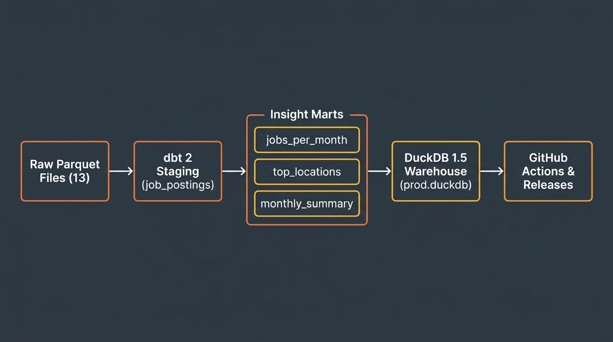

# 🚀 dbt + DuckDB Job Market Pipeline

[](https://github.com/heltonwo/dbt-duckdb-pipeline/actions)


An end-to-end analytics engineering project that transforms 12 months of raw job postings (July 2025 – June 2026) into tested, documented insight marts using **dbt 2** and **DuckDB**. The pipeline is rebuilt automatically by **GitHub Actions**, and the final warehouse is published as a downloadable DuckDB file that anyone can query remotely with DuckDB.

---

## 📌 Overview

| What I Built | How I Implemented | Where to Look |
|---|---|---|
| **dbt pipeline** | Source → cleaned model → insight marts | [`analytics/models`](analytics/models) |
| **Data tests** | `unique` / `not_null` on key columns | [`schema.yml`](analytics/models/schema.yml) |
| **Hosted dbt docs** | Lineage, descriptions and column-level metadata | [Live docs site](https://heltonwo.github.io/dbt-duckdb-pipeline/) |
| **Public CI/CD** | Build + test + publish on every push and weekly | [Actions workflow](.github/workflows/dbt_build.yml) |
| **Environments** | Local development vs. CI `prod` target | [`ci/profiles.yml`](ci/profiles.yml) |
| **Published warehouse** | Remotely queryable via DuckDB | [Query it](#-query-the-published-warehouse) |

---

## 🏗️ Architecture



| Layer | Model | Description |
|---|---|---|
| Staging | `job_postings` | Cleaned job postings: `job_id`, `job_title`, `company_name`, `job_location`, `job_via`, `job_schedule_type`, `job_work_from_home`, `search_date`, `search_term` |
| Mart | `jobs_per_month` | Postings per month and role |
| Mart | `top_locations` | Top 10 locations by number of postings |
| Mart | `monthly_summary` | Total postings, remote postings and remote share (%) per month |

---

## 📈 Key Insights

Extracted from the `prod.duckdb` marts across 691,950 job postings (July 2025 – June 2026):

- **Role demand:** **Data Engineer** leads with **413,320** postings (59.7%), ahead of **Data Analyst** (**176,350**, 25.5%) and **Data Scientist** (**102,280**, 14.8%).
- **Seasonality & volume:** Posting volume peaked in **July 2025** (**96,463** postings) and hit its low in **February 2026** (**29,195** postings).
- **Remote share:** **45,609** postings (**6.6%** overall) are remote, ranging from **4.1%** in August 2025 to **10.4%** in June 2026.
- **Top locations:** **Anywhere** (a catch-all label rather than a city) leads with **45,596** postings, followed by **Singapore** (**12,652**), **New York, NY** (**12,014**), **India** (**7,291**), and **Chicago, IL** (**7,277**).

---

## ✅ Data Quality

Tests run as part of every `dbt build`:

- `not_null` on `job_postings.job_title`
- `unique` on `monthly_summary.month`

Result of the latest build: **4 models, 2 tests, 6/6 successful**.

---

## 🔄 CI/CD Pipeline

The workflow [`dbt_build.yml`](.github/workflows/dbt_build.yml) runs on:

- every push to `main`
- a weekly schedule (Mondays, 06:17 UTC)
- manual trigger (`workflow_dispatch`)

**Steps**

1. Check out the repository
2. Install `uv` and sync the locked dependencies (`uv sync`)
3. Download the raw Parquet files (`scripts/download_data.py`)
4. Run `dbt build` against the CI profile
5. Publish `prod.duckdb` to the `warehouse` GitHub Release (replaced on every run)

---

## 🦆 Query the Published Warehouse

No installation of the project is required. With the DuckDB CLI (version 1.5 or newer):

```sql
INSTALL httpfs;
LOAD httpfs;

ATTACH 'https://github.com/heltonwo/dbt-duckdb-pipeline/releases/download/warehouse/prod.duckdb'
AS jobs (READ_ONLY);

SHOW ALL TABLES;

SELECT *
FROM jobs.main.monthly_summary
ORDER BY month;
```

Direct download: [`prod.duckdb`](https://github.com/heltonwo/dbt-duckdb-pipeline/releases/download/warehouse/prod.duckdb)

---

## 📚 dbt Documentation

Browse the lineage graph, model descriptions and column metadata on the [live docs site](https://heltonwo.github.io/dbt-duckdb-pipeline/).

---

## 🛠️ Run It Locally

**Prerequisites:** Python 3.12+ and [`uv`](https://docs.astral.sh/uv/).

```bash
# 1. Clone and install the locked dependencies
git clone https://github.com/heltonwo/dbt-duckdb-pipeline.git
cd dbt-duckdb-pipeline
uv sync

# 2. Download the raw data
uv run python scripts/download_data.py

# 3. Build models and run tests
cd analytics
uv run dbt build --profiles-dir ../ci
```

The result is written to `data/prod.duckdb`.

---

## 🧰 Tech Stack

| Tool | Purpose |
|---|---|
| **dbt 2.0** | Transformation, testing and documentation (DuckDB adapter built in) |
| **DuckDB 1.5** | Analytical engine and portable warehouse file |
| **uv** | Reproducible Python environments via `uv.lock` |
| **GitHub Actions** | Automated build, test and publish |
| **GitHub Releases** | Hosting for the published warehouse |

---

## 📝 Engineering Notes

- **Native DuckDB integration.** dbt 2 includes built-in DuckDB support, so the separate `dbt-duckdb` adapter (which pulls in `dbt-core` 1.x) is no longer needed.
- **Reproducible builds.** CI installs Python dependencies from the committed `uv.lock`, ensuring consistent environments between local development and GitHub Actions.

---

## 🗂️ Project Layout

```text
.
├── .github/workflows/dbt_build.yml   # public CI: build, test, publish
├── ci/profiles.yml                   # prod DuckDB target for Actions
├── data/                             # raw + warehouse (CI regenerates)
├── docs/                             # dbt docs site (GitHub Pages)
├── images/                           # architecture diagram
├── analytics/
│   ├── dbt_project.yml
│   └── models/                       # models, source.yml, schema.yml
└── scripts/download_data.py          # fetch raw Parquet before build
```